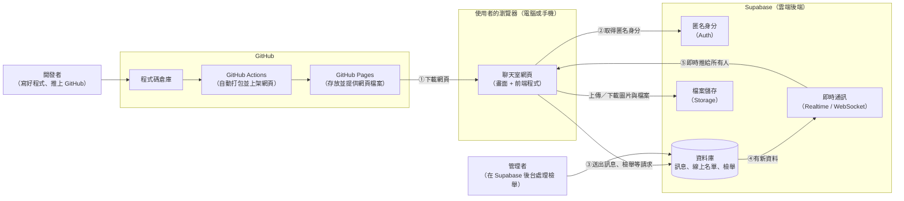
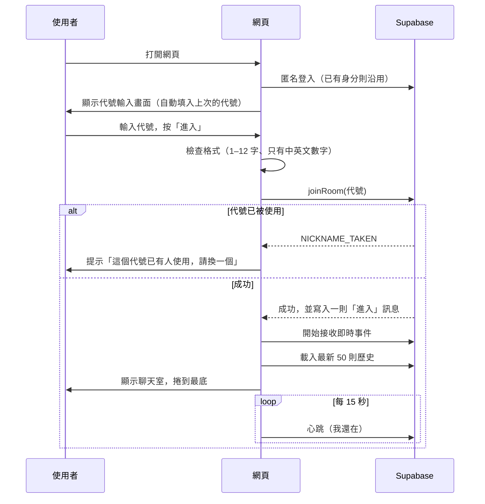
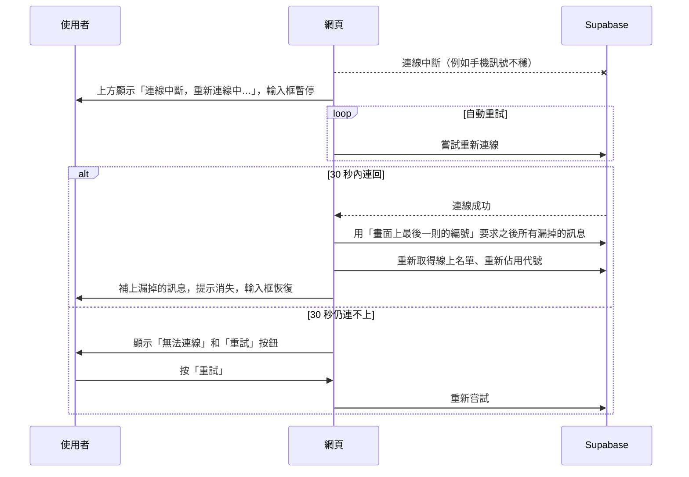

# 匿名聊天室 架構文件

> 這份文件寫給「不寫程式的專案負責人」看。每個專業名詞第一次出現時，都會用一句話解釋。畫面的顏色、字型、排版細節不在這裡規定，那是 `/design` 的工作。

---

## 1. 專案說明與目標

**這是什麼**：一個不用註冊、不用登入的匿名聊天室。所有人都在同一個聊天室裡，任何拿到網站連結的人，用電腦或手機都能進來聊天。

**使用者會做的事**

1. 打開網頁，輸入一個代號（暱稱）。
2. 進入聊天室，看到所有人的歷史訊息，也能送出文字、圖片、檔案。
3. 看得到誰在線上、誰進來了、誰離開了，也看得到誰正在打字。
4. 可以修改或刪除自己的訊息，也可以檢舉不當的訊息。

**這個專案的目標**

- 開啟連結就能聊，零門檻。
- 電腦與手機都好用。
- 完全用免費或低成本的服務架起來，不需要自己租伺服器。
- 先把畫面做好、放上網看得到，最後才接上真正的即時傳訊功能。

**需求訪談的結論一覽**

| 項目 | 決定 |
|---|---|
| 代號 | 只能用中文、英文、數字；1 到 12 個字；「目前線上的人」之中不可重複；瀏覽器會記住上次用的代號並自動填入 |
| 離開 | 有「離開」按鈕；直接關網頁也算離開；離開後代號釋放給別人 |
| 歷史訊息 | 新進來的人看得到全部歷史，可以一直往上捲 |
| 訊息內容 | 文字（不限字數、不能全空）、圖片、任何檔案。圖片直接顯示，其他檔案顯示成下載連結。網址自動變成可點的連結 |
| 訊息外觀 | 顯示代號、內容、時間；自己的訊息靠右、別人靠左、顏色不同 |
| 修改／刪除 | 可改、可刪自己的訊息。改過標示「已編輯」，刪除後留下「此訊息已刪除」 |
| 線上狀態 | 顯示「目前 N 人在線」，點一下展開名單；進出時在對話裡插入一行置中灰色小字 |
| 輸入中 | 顯示「某某 正在輸入…」 |
| 捲動 | 往上看舊訊息時有新訊息：畫面不動，底部出現「有 N 則新訊息 ↓」按鈕；人在最底下時自動捲到底 |
| 輸入方式 | 電腦：Enter 送出、Shift+Enter 換行；手機：Enter 換行，按「送出」按鈕 |
| 防濫用 | 短時間內送太多則會被擋；可檢舉，同一則被 3 個不同的人檢舉後自動隱藏，由管理者決定刪除或恢復 |
| 外觀 | 介面全繁體中文；淺色／深色兩種，右上角手動切換 |
| 斷線 | 顯示「重新連線中…」，連回後補上漏掉的訊息；30 秒連不上顯示「無法連線」與「重試」 |
| 背景提醒 | 分頁標題顯示未讀數，例如「(3) 匿名聊天室」 |

---

## 2. 整體架構圖

用一句話說：**網頁本身放在 GitHub Pages（免費的網頁空間），聊天資料與即時傳訊交給 Supabase（提供資料庫與即時通訊的雲端服務）。我們不需要自己架任何伺服器。**



**怎麼讀這張圖**

- ① 使用者打開連結，瀏覽器從 GitHub Pages 下載網頁。這個網頁是「靜態」的，意思是它只是一包固定的檔案，不會自己處理資料。
- ②～⑤ 網頁下載後，所有跟聊天有關的事（身分、存訊息、即時推送）都是瀏覽器直接跟 Supabase 溝通，不經過 GitHub。
- **WebSocket**：一種讓瀏覽器與伺服器保持「一直連著」的通訊方式。伺服器有新訊息時可以立刻推給你，不用你一直問「有新訊息嗎？」。聊天室的即時感就是靠它。

---

## 3. 技術選擇

每一項都寫「選了什麼」和「為什麼」。

### 3.1 前端（使用者看到和操作的部分）

| 項目 | 選了什麼 | 為什麼 |
|---|---|---|
| 程式語言 | **TypeScript**（一種 JavaScript 的加強版，會在寫程式時就檢查資料格式有沒有搞錯） | 聊天室裡有很多種資料（訊息、使用者、附件、檢舉），格式一弄錯就會出怪問題。TypeScript 可以在還沒上線前就抓到大部分這類錯誤 |
| 框架 | **React**（一套很普及的網頁開發工具，擅長「資料變了，畫面自動跟著變」） | 聊天室剛好就是這種情境：新訊息來了、有人上線、有人打字，畫面都要立刻更新。React 的資料量與教學資源也最多，後續找人幫忙或維護最容易 |
| 打包工具 | **Vite**（把寫好的程式整理成瀏覽器能直接用的一包檔案） | 打包出來是純靜態檔案，剛好可以放 GitHub Pages；開發時速度很快 |
| 樣式 | **一般的 CSS**，用「顏色變數」管理淺色／深色 | 淺色與深色只要換一組變數，不需要額外套件，之後 `/design` 想改風格也很容易 |
| 畫面切換 | 不使用網址路由 | 只有「輸入代號」和「聊天室」兩個主畫面，用一個狀態切換就夠，也避免 GitHub Pages 對網址路徑的限制 |

### 3.2 後端（資料與即時傳訊）：用 Supabase 的哪些功能

**Supabase** 是一個把資料庫、即時通訊、檔案儲存、身分管理包在一起的雲端服務，有免費方案。

| Supabase 功能 | 用在哪裡 | 為什麼 |
|---|---|---|
| **匿名登入**（Anonymous Sign-in） | 每個瀏覽器自動取得一個看不見的身分編號 | 使用者完全不用登入，但系統能分辨「這則訊息是不是你送的」。這是「只能改自己的訊息」和「同一人不能重複檢舉」的基礎 |
| **資料庫**（Postgres，一種常見的資料庫） | 存訊息、線上名單、檢舉紀錄 | 歷史訊息需要永久保存，也需要排序、分頁查詢 |
| **資料庫函式**（可以理解成存在資料庫裡的「辦事流程」） | 佔用代號、送訊息、改訊息、刪訊息、檢舉、離開 | 規則（例如 10 秒最多 5 則、代號不能重複）寫在這裡，**使用者無法繞過**。如果規則只放在前端，有心人直接對資料庫送資料就能略過 |
| **資料列安全規則**（RLS，Row Level Security：規定誰能讀、誰能寫哪些資料） | 所有資料表 | 因為網頁裡的金鑰是公開的（見第 8 節），真正的保護就靠這層規則 |
| **即時通訊—資料變動推送**（Realtime / Postgres Changes） | 新訊息、訊息被改／刪／隱藏、線上名單變動 | 資料庫有變動時，自動經由 WebSocket 推給所有人，這正是需求指定的做法 |
| **即時通訊—廣播**（Realtime / Broadcast） | 「正在輸入…」 | 這種資訊用完即丟，不必存進資料庫，用廣播最省資源 |
| **檔案儲存**（Storage） | 圖片與檔案 | 檔案不適合塞進資料庫，要另外存放 |

**為什麼線上名單不用 Supabase 內建的 Presence（在線狀態）功能？**
Presence 很適合顯示名單，但它**沒辦法保證兩個人同時搶同一個代號時只有一個成功**，也沒辦法把「進入／離開」寫進永久的歷史。所以我們自己做一張「線上名單」資料表，由「心跳」機制維護（見第 6 節）。

**匿名登入的限制（請先知道）**
- 身分存在使用者的瀏覽器裡。**清除瀏覽資料、換瀏覽器、換手機，就會變成一個新的人**，無法再修改或刪除過去自己送的訊息。這是「不用登入」必然的代價。
- 匿名登入有可能被程式大量註冊。第一版先靠「送訊息頻率限制」擋住；如果真的被濫用，可以在 Supabase 後台開啟人機驗證（Cloudflare Turnstile，就是那個「我不是機器人」的小勾選）。

---

## 4. 兩個階段，以及前端怎麼設計才不用重寫

### 4.1 階段一：還沒接 Supabase

**目標**：先把畫面和操作流程完整做出來，放上 GitHub Pages，讓你用電腦和手機實際看到、摸到。

**階段一前端做得到的事**

| 功能 | 階段一的做法 |
|---|---|
| 輸入代號、檢查格式 | 完整可用（規則與正式版相同）|
| 代號重複 | 模擬：假裝有幾個人在線（例如「小美」「阿德」），輸入同名會被擋 |
| 送出文字／圖片／檔案 | 可用，內容存在**這台裝置的瀏覽器**裡（重新整理後歷史還在）；圖片與檔案也只存在本機 |
| 他人的訊息 | 由「模擬的人」定時說話，讓你看到靠左的訊息、進出提示、「正在輸入…」 |
| 線上名單、人數 | 可用，來源是模擬的人加上你自己 |
| 修改、刪除、檢舉 | 可用；檢舉可以用「模擬其他人」達到 3 人門檻，看隱藏的效果 |
| 往上捲載入更多歷史、「N 則新訊息」按鈕 | 可用，系統會預先放入大量假歷史訊息 |
| 斷線提示 | 在頁面網址後面加 `?debug=1`，會出現一個「測試面板」，可以按鈕模擬斷線、重連、連線失敗、被洗版限制 |
| 淺色／深色、手機版版面、分頁標題未讀數 | 完整可用 |
| 開兩個分頁互相聊 | 同一個瀏覽器、同一台電腦的兩個分頁可以互通（用瀏覽器內建的分頁通訊功能），方便展示 |

**階段一做不到的事**：真正的「不同人、不同裝置」之間互相傳訊。因為訊息只存在你自己的瀏覽器裡，換一支手機看不到。這要等階段二。

**怎麼在 GitHub Pages 上看到**：第 12 節說明。只要把程式推上 GitHub，系統會自動打包並上架，之後打開 `https://<你的帳號>.github.io/<倉庫名稱>/` 就能看到。

### 4.2 階段二：接上 Supabase 之後的改變

| 項目 | 階段一 | 階段二 |
|---|---|---|
| 資料存放 | 瀏覽器本機 | Supabase 資料庫 |
| 其他人 | 模擬的 | 真人，不同裝置都能互通 |
| 代號重複判斷 | 對照模擬名單 | 資料庫保證，同時搶同一個代號也只有一人成功 |
| 規則檢查 | 只在前端 | 前端 + 資料庫函式雙重把關（前端是為了體驗，資料庫是為了安全）|
| 身分 | 無 | 匿名登入 |
| 檔案 | 存在本機 | 存在 Supabase 檔案儲存 |
| 即時推送 | 瀏覽器內部模擬 | 真正的 WebSocket |
| 離線判斷 | 模擬 | 心跳機制 |
| 需要的設定 | 無 | 兩個公開設定值（見第 8 節）|

### 4.3 兩個階段之間，前端程式怎麼設計才不用整個重寫

**核心概念：像「插座」一樣的介面。**

把前端分成兩層：

1. **畫面層**：所有你看得到的東西（輸入框、訊息列表、線上名單…）。
2. **資料層**：所有「取得／送出資料」的事（送訊息、載入歷史、訂閱新訊息…）。

兩層中間定一份**固定的約定**（第 5 節的「事件與動作清單」）。畫面層只會說「我要送出一則訊息」，**完全不知道**資料層背後是假資料還是 Supabase。

- 階段一：資料層用「模擬版」（`mockBackend`）。
- 階段二：資料層換成「Supabase 版」（`supabaseBackend`）。

換的時候，畫面層一行都不用動，只要把插頭從模擬版換成 Supabase 版。同時，**所有規則（代號格式、字數、網址轉連結等）只寫一份**，兩個階段共用，不會出現前後不一致。

**另外兩個做法讓切換更順利**

- 階段一的模擬版也會故意模擬「慢」「失敗」「被限制」，讓畫面在階段一就把這些情況處理好，階段二就不會有驚喜。
- 約定裡的錯誤情況（例如「代號已被使用」「說話太快」）在階段一就全部定義好，兩邊用同樣的錯誤代碼。

---

## 5. 通訊約定

這一節定義「畫面層」與「資料層」之間的約定。階段一的模擬版與階段二的 Supabase 版，都要遵守同一份約定。（**JSON** 是一種用文字表示資料的通用格式，下面的範例都是這種格式。）

### 5.1 動作（畫面層 → 資料層：「我想做某件事」）

| 動作名稱 | 要帶的資料 | 成功時回傳 | 可能的失敗原因 |
|---|---|---|---|
| `joinRoom` | 代號 | 目前線上名單 | `NICKNAME_INVALID`（格式不對）、`NICKNAME_TAKEN`（已被使用） |
| `leaveRoom` | 無 | 無 | 無 |
| `sendMessage` | 文字、附件（可空） | 新訊息 | `NOT_JOINED`、`EMPTY_MESSAGE`、`RATE_LIMITED`、`FILE_TOO_LARGE` |
| `editMessage` | 訊息編號、新文字 | 更新後訊息 | `NOT_OWNER`、`ALREADY_DELETED`、`EMPTY_MESSAGE` |
| `deleteMessage` | 訊息編號 | 更新後訊息 | `NOT_OWNER` |
| `reportMessage` | 訊息編號 | 無 | `OWN_MESSAGE`（不能檢舉自己）、`ALREADY_REPORTED` |
| `loadHistory` | 起點訊息編號、數量 | 一批訊息（舊的在前）| `NETWORK` |
| `uploadFile` | 檔案 | 附件資訊 | `FILE_TOO_LARGE`、`NETWORK` |
| `notifyTyping` | 無 | 無 | 無 |
| `retryConnection` | 無 | 無 | 無 |

### 5.2 事件（資料層 → 畫面層：「剛剛發生了某件事」）

| 事件名稱 | 什麼時候發生 | 帶的資料 |
|---|---|---|
| `message.created` | 任何人送出新訊息，或有人進出（系統訊息） | 一則訊息 |
| `message.updated` | 訊息被編輯、刪除，或被自動隱藏／恢復 | 更新後的訊息 |
| `presence.changed` | 有人上線或離線 | 完整的線上名單 |
| `typing.started` | 有人正在輸入 | 輸入者代號 |
| `connection.changed` | 連線狀態改變 | `connected`（已連線）、`reconnecting`（重新連線中）、`failed`（連線失敗）|

### 5.3 資料格式

**訊息**

```json
{
  "id": 1042,
  "kind": "chat",
  "nickname": "小明",
  "isMine": false,
  "text": "大家好 https://example.com",
  "attachment": null,
  "createdAt": "2026-10-13T14:32:08Z",
  "edited": false,
  "deleted": false,
  "hidden": false
}
```

| 欄位 | 說明 |
|---|---|
| `id` | 訊息編號，一直往上加，同時是排序依據，也是斷線後「補漏」的依據 |
| `kind` | 訊息種類：`chat`（一般訊息）、`join`（有人進入）、`leave`（有人離開）|
| `nickname` | 送出當下的代號 |
| `isMine` | 是不是自己送的。畫面靠它決定靠左或靠右 |
| `text` | 文字內容；被刪除或隱藏時為空 |
| `attachment` | 附件，沒有則為空 |
| `createdAt` | 送出時間 |
| `edited` | 為真時顯示「已編輯」 |
| `deleted` | 為真時顯示「此訊息已刪除」 |
| `hidden` | 為真時顯示「此訊息因多人檢舉已隱藏」 |

**附件**

```json
{
  "kind": "image",
  "name": "貓咪.jpg",
  "size": 482113,
  "mime": "image/jpeg",
  "url": "https://……"
}
```

`kind` 只有兩種：`image`（畫面直接顯示）、`file`（顯示成下載連結）。`size` 是位元組數。

**線上名單**

```json
{ "users": [ { "nickname": "小明" }, { "nickname": "小美" } ] }
```

**錯誤**

```json
{ "code": "RATE_LIMITED", "message": "說話太快了，請稍等" }
```

畫面是依照 `code` 決定要顯示什麼提示，不依賴 `message` 的文字。

### 5.4 資料庫裡存了什麼（階段二）

用白話描述四份資料：

| 資料 | 內容 | 誰能讀 | 誰能寫 |
|---|---|---|---|
| **訊息表** | 所有訊息（含進出提示）：編號、種類、送出者身分、代號、文字、附件、時間、是否編輯／刪除／隱藏 | 所有已匿名登入的使用者 | 沒有人能直接寫，只能透過「資料庫函式」|
| **線上名單表** | 目前在線的人：代號、佔用者身分、最後心跳時間。**代號欄位設為唯一**，這就是「線上不可重複」的保證 | 所有已匿名登入的使用者 | 只能透過函式 |
| **檢舉表** | 誰檢舉了哪一則。「同一人＋同一則」只能有一筆 | 沒有人（管理者在後台可看）| 只能透過函式 |
| **隱藏內容表** | 被自動隱藏的訊息的原文與附件 | 沒有人（管理者在後台可看）| 只能透過函式 |

被隱藏的訊息，原文會**從訊息表搬走**、放進隱藏內容表。這樣即使有人繞過網頁、直接查資料庫，也拿不到被隱藏的內容。管理者「恢復」時再搬回來。

---

## 6. 資料流

### 6.1 進入聊天室



要點：
- **心跳**：網頁每隔一小段時間告訴系統「我還在線上」，就像定期敲一下門。超過一段時間沒敲，系統就當作這個人已離開。
- 如果同一個瀏覽器重新連線並使用同一個代號，系統會視為同一個人接手，不會被擋。

### 6.2 送出訊息

1. 使用者按送出（或電腦按 Enter）。
2. 前端先檢查：全空就不送。
3. 若有檔案，先上傳檔案（超過 10 MB 前端直接提示；上傳期間輸入框顯示進度）。
4. 呼叫 `sendMessage`。系統檢查：是否已進入、內容是否全空、10 秒內是否超過 5 則。
5. 通過後存進資料庫，**所有人（包含自己）**同時收到 `message.created`，畫面才出現這則訊息。
6. 被擋時顯示對應提示（例如「說話太快了，請稍等」），輸入框內容保留，不會讓使用者白打。
7. 其他人的畫面：如果人在最底下就自動捲到底；如果在往上看舊訊息，就顯示「有 N 則新訊息 ↓」。

### 6.3 離開

**主動離開**（按「離開」按鈕）：呼叫 `leaveRoom` → 從線上名單移除、寫入一則「離開」訊息 → 畫面回到代號輸入畫面（代號立即釋放）。

**直接關網頁**：瀏覽器關閉的瞬間，網頁會盡力通知系統「我要走了」。但這個通知**不保證送得到**（例如手機直接被系統關掉），所以還有備案：

- 超過 **45 秒**沒有心跳，系統就視為離線。
- 清理的時機：下一個送出心跳或進入聊天室的人，會順手把逾時的人清掉，並替他們補上「離開」訊息。
- 好處：不需要額外的排程機制。只要有人在線就會有人清理；如果完全沒人，下一個進來的人會清理。

### 6.4 斷線重連



要點：
- 斷線期間若超過 45 秒，系統會把你當作離開；重連時網頁會自動重新取得代號。若這時代號剛好被別人用了，會回到代號輸入畫面請你換一個，並說明原因。
- 補漏是靠「訊息編號只增不減」：只要告訴系統「我看到 1042 為止」，它就能補上 1043 之後的全部。
- 斷線期間，你已經在畫面上看到的訊息不會消失。

### 6.5 其他流程簡述

- **修改訊息**：只有自己的訊息出現「編輯」；改完所有人看到新內容並標示「已編輯」。
- **刪除訊息**：只有自己的訊息出現「刪除」；所有人看到變成「此訊息已刪除」，原文與附件從資料庫清除。
- **檢舉訊息**：別人的訊息出現「檢舉」；按下後顯示「已收到檢舉，謝謝」。同一則累計 3 個不同的人檢舉，內容自動隱藏。
- **管理者處理**：到 Supabase 後台查看被隱藏的訊息，決定刪除，或「恢復」。恢復後標記為「管理者已確認」，之後不再被自動隱藏。
- **正在輸入**：使用者打字時，每 2 秒最多通知一次；對方畫面顯示 3 秒，沒收到新通知就消失。這個通知不存進資料庫。

---

## 7. 畫面清單

以下只寫「有什麼元素、做什麼事」，不規定外觀。

### 7.1 代號輸入畫面

| 元素 | 行為 |
|---|---|
| 標題／簡短說明 | 說明這是匿名聊天室、所有人在同一個房間 |
| 代號輸入框 | 自動填入上次使用的代號；輸入時即時顯示規則（1–12 字、只能中英文數字）；不符合格式時提示原因並禁止進入 |
| 「進入」按鈕 | 檢查通過才可按；送出後顯示「進入中…」避免重複點擊 |
| 錯誤提示 | 代號已被使用時，顯示「這個代號已有人使用，請換一個」，輸入框保持焦點 |
| 淺色／深色切換 | 右上角，切換後記住偏好 |
| 提示文字 | 提醒使用者：所有訊息會永久保存、所有人可見 |

### 7.2 聊天室主畫面

**頂部列**

| 元素 | 行為 |
|---|---|
| 聊天室名稱 | 顯示名稱 |
| 「N 人在線」 | 點一下展開線上名單，再點收起 |
| 淺色／深色切換 | 右上角 |
| 「離開」按鈕 | 按下後回到代號輸入畫面，並釋放代號 |

**連線狀態提示條**（平常隱藏）

| 狀態 | 顯示 |
|---|---|
| 重新連線中 | 「連線中斷，重新連線中…」；輸入框暫停 |
| 連線失敗 | 「無法連線」與「重試」按鈕 |

**訊息列表**

| 元素 | 行為 |
|---|---|
| 一般訊息 | 顯示代號、內容、時間；自己靠右、別人靠左、顏色不同；超過一天的訊息時間加上日期 |
| 系統訊息 | 置中灰色小字，例如「小明 進入了聊天室」，會留在歷史裡 |
| 已編輯標記 | 該則旁邊顯示「已編輯」 |
| 已刪除訊息 | 顯示「此訊息已刪除」 |
| 已隱藏訊息 | 顯示「此訊息因多人檢舉已隱藏」 |
| 圖片附件 | 直接顯示縮圖；點一下放大 |
| 檔案附件 | 顯示檔名、大小、下載連結 |
| 網址 | 自動變成可點連結，在新分頁開啟 |
| 訊息操作 | 自己的訊息：編輯、刪除；別人的訊息：檢舉 |
| 往上捲到頂 | 自動載入更早的 50 則；全部載完後顯示「已經是最早的訊息」 |
| 「有 N 則新訊息 ↓」按鈕 | 只在使用者往上看舊訊息時出現；點一下跳到最新並消失 |
| 空狀態 | 還沒有任何訊息時顯示鼓勵發言的文字 |
| 載入狀態 | 載入歷史時顯示載入中 |

**線上名單面板**

| 元素 | 行為 |
|---|---|
| 人數與代號清單 | 即時更新，自己有特別標記 |

**正在輸入提示**

| 元素 | 行為 |
|---|---|
| 「某某 正在輸入…」 | 在輸入框上方；多人同時輸入時顯示「數人正在輸入…」|

**輸入區**

| 元素 | 行為 |
|---|---|
| 文字輸入框 | 多行；電腦 Enter 送出、Shift+Enter 換行；手機 Enter 換行 |
| 「附件」按鈕 | 選圖片或任何檔案；選好後顯示預覽與取消按鈕；超過 10 MB 提示 |
| 「送出」按鈕 | 內容與附件都空時不可按；上傳或送出中顯示進度 |
| 錯誤提示 | 被洗版限制時顯示「說話太快了，請稍等」，輸入內容保留 |

**編輯狀態**：按「編輯」後，該則訊息變成輸入框，有「儲存」「取消」。

**其他行為**
- 分頁在背景時，標題顯示未讀數，例如「(3) 匿名聊天室」，回到分頁後清除。
- 手機版：線上名單預設收合，輸入區固定在底部，鍵盤彈出時不被遮住。

### 7.3 圖片放大檢視

| 元素 | 行為 |
|---|---|
| 大圖 | 點圖片後蓋住畫面顯示 |
| 關閉 | 點空白處或關閉按鈕 |
| 下載 | 可下載原圖 |

---

## 8. 金鑰

**金鑰**就是一串程式用來向 Supabase 證明身分的長字串。這個專案只會碰到下面這些：

| 名稱 | 是什麼 | 能公開嗎 | 說明 |
|---|---|---|---|
| **Project URL**（專案網址） | 你的 Supabase 專案的網址 | ✅ 可以 | 不算祕密 |
| **Publishable key**（可公開金鑰；舊版叫 anon key） | 讓網頁能連到你的 Supabase 專案 | ✅ **可以，而且必須公開** | 它被設計成會出現在每個人的瀏覽器裡。真正的保護靠第 3.2 節的「資料列安全規則」，不是靠藏起這把鑰匙 |
| **Secret key**（祕密金鑰；舊版叫 service_role key） | 擁有資料庫最高權限，可以略過所有安全規則 | ❌ **絕對不能公開** | 一旦外洩，任何人都能讀取、修改、刪除所有資料。**這個專案完全不使用它** |
| **資料庫密碼** | 建立專案時設定的密碼 | ❌ 絕對不能公開 | 只在你自己登入後台時用，不放進任何程式或倉庫 |

### 8.1 怎麼產生

1. 登入 Supabase，建立一個新專案（建立時需要設定資料庫密碼，請存在你自己的密碼管理工具裡）。
2. 專案建立後，到 **Project Settings → API Keys**。
3. 那裡會看到 Project URL 與 Publishable key，這就是網頁需要的兩個值。Secret key 也在同一頁，**不要複製它**。
4. 到 **Authentication → Providers（或 Sign In / Up）** 開啟 **Anonymous Sign-ins**（匿名登入）。

（以上畫面名稱以 Supabase 當時的介面為準，介面可能改版。）

### 8.2 放在哪裡

| 場合 | 放的位置 | 內容 |
|---|---|---|
| 你的電腦上開發時 | 專案資料夾裡的 `.env.local` 檔案 | 兩個值：專案網址、可公開金鑰 |
| 倉庫裡給別人參考 | `.env.example` 檔案 | 只有欄位名稱，**沒有真實的值** |
| 上架到 GitHub Pages 時 | GitHub 倉庫 → Settings → Secrets and variables → Actions → **Variables** | 同樣兩個值。因為這兩個值本來就會出現在瀏覽器裡，放在 Variables 即可 |
| Secret key、資料庫密碼 | **不放在任何地方**（專案不用）| 只留在你自己的密碼管理工具 |

### 8.3 怎麼避免被 commit 到 GitHub

**commit** 是把檔案的變更記錄進 Git 並推上 GitHub 的動作。一旦推上去，即使之後刪除，歷史紀錄裡仍可能被找到。防範方式：

1. `.gitignore`（告訴 Git「這些檔案不要追蹤」的清單）寫入 `.env`、`.env.*`，只放行 `.env.example`。**這項在建立專案的第一個 commit 就要設好**。
2. 程式碼裡**不直接寫死**任何金鑰，一律從環境設定讀取。
3. 開啟 GitHub 倉庫的 **Secret scanning / Push protection**（GitHub 內建的功能，推送內容含有疑似金鑰時會擋下來並警告）。
4. 每次 commit 前，用 `git status` 檢查要提交的檔案清單，確認沒有 `.env` 之類的檔案。
5. **萬一外洩**：
   - 如果外洩的是 Publishable key：影響有限，但仍建議到 Supabase 後台重新產生。
   - 如果外洩的是 Secret key 或資料庫密碼：**立刻**到 Supabase 後台重新產生（舊的立即失效），再檢查資料有沒有被動過。只刪除 GitHub 上的檔案是不夠的。

---

## 9. 安全與限制

### 9.1 別人可以送什麼奇怪的東西進來，前端怎麼擋

> 重要原則：**前端的檢查是為了讓一般使用者體驗好；真正的防線在資料庫函式與安全規則，因為有心人可以跳過網頁，直接對資料庫送資料。**所以每一項都會在「前端」和「資料庫」各擋一次。

| 可能的狀況 | 前端怎麼處理 | 資料庫怎麼處理 |
|---|---|---|
| 代號含空白、符號、表情符號、超過 12 字 | 輸入時即時提示、禁止進入 | 函式再次檢查格式，不符合直接拒絕 |
| 代號用全形字、零寬字元、長得像別人的字來冒充 | 只允許半形英數與中文，以規則表達式嚴格比對 | 同樣規則 |
| 訊息內容夾帶網頁程式碼（例如 `<script>`），想攻擊其他人的瀏覽器 | 一律當成**純文字**顯示，絕不當成網頁語法解讀 | 不信任內容、原樣存放 |
| 網址偽裝（例如 `javascript:` 開頭的假連結）| 只把 `http://` 和 `https://` 開頭的轉成連結，其他一律維持純文字；連結都加上「不傳遞來源」保護，並在新分頁開啟 | 無需處理 |
| 超長的單一訊息或一長串無空格文字撐破版面 | 版面設計成自動換行，過長內容以「展開／收合」處理 | 設定一個很大的安全上限，避免單則吃掉資料庫 |
| 全空白訊息 | 不可送出 | 函式拒絕 |
| 短時間洗版 | 送出後若被擋，顯示「說話太快了，請稍等」 | **10 秒內最多 5 則**，由資料庫判定，改程式也繞不過 |
| 超大檔案 | 超過 10 MB 在選檔時就提示 | 檔案儲存也設定 10 MB 上限 |
| 偽裝的檔案（改了副檔名）| 只把「類型為圖片」的檔案當圖片顯示；其他一律只提供下載，不在網頁內執行 | 檔案存放在另一個網域，不會跟聊天室網頁混在一起執行 |
| 特大圖片（尺寸驚人）| 以固定大小的縮圖顯示 | 無 |
| 冒充別人修改或刪除訊息 | 只在自己的訊息上顯示編輯／刪除 | 函式用匿名身分編號比對，非作者一律拒絕 |
| 重複檢舉、檢舉自己、一個人灌檢舉 | 按過後按鈕變灰 | 「同一人＋同一則」只算一次；不能檢舉自己的訊息 |
| 假造別人的代號送訊息 | 不適用 | 送出時使用的代號由系統根據「佔用者身分」決定，不是由前端自己宣告 |
| 大量註冊匿名身分來規避限制 | 無 | 必要時開啟人機驗證（Turnstile）|
| 同一個人開多個分頁 | 無 | 同一個匿名身分可重新接手同一個代號；其中一個分頁關閉可能讓另一個短暫被判離線，下一次心跳會自動恢復 |
| 不當內容（圖片、檔案）| 無法事先過濾 | 靠檢舉機制自動隱藏，再由管理者事後處理 |

### 9.2 免費方案的上限（需要留意）

> 以下數字是撰寫文件時的大致印象，**請以 Supabase 與 GitHub 官方網站當下公布的方案為準**，上線前請再確認一次。

| 項目 | 大致上限 | 對這個專案的影響 | 建議 |
|---|---|---|---|
| 資料庫容量 | 約 500 MB | 純文字訊息很小，可聊很久 | 偶爾檢查用量 |
| 檔案儲存 | 約 1 GB | **最容易先滿的項目**，因為訊息永久保存、圖片佔空間大 | 定期到後台清理；單檔限制 10 MB；必要時考慮付費 |
| 單檔大小 | 免費方案有全域上限（約 50 MB）| 我們自己設的 10 MB 更嚴格 | 無 |
| 同時連線人數 | 免費方案有上限（約 200 條即時連線）| 超過時新使用者可能連不上 | 熱門時需升級 |
| 即時訊息量 | 每月有總量上限 | 「正在輸入」每 2 秒一次已經刻意降低頻率 | 觀察用量 |
| 流量（下載量）| 每月有總量上限 | 圖片被反覆下載會消耗 | 圖片以縮圖顯示 |
| 閒置暫停 | 免費專案一段時間（約一週）沒人使用會被暫停 | 暫停後聊天室打不開 | 定期登入後台或手動恢復 |
| GitHub Pages | 網站大小與每月流量有上限（量很大）| 一般用量不會碰到 | 無 |

另外：免費方案**通常沒有自動備份保證**，歷史訊息如果重要，需要自己定期匯出。

---

## 10. 這一版刻意不做的事，以及為什麼

| 不做的事 | 為什麼 |
|---|---|
| 註冊、登入、密碼 | 需求明確不要；匿名登入是在背後自動完成的，使用者無感 |
| 多個聊天室、私訊 | 需求是「所有人在同一個聊天室」，先把一個房間做好 |
| 新訊息提示音 | 在辦公室、教室容易嚇到人；分頁標題未讀數已足夠，之後想加再補 |
| 瀏覽器推播通知（頁面關閉後仍通知）| 需要額外的授權流程與背景服務，複雜度高，且關掉頁面就等同離線 |
| 自動過濾不當文字或圖片 | 需要額外的審查服務，成本高；第一版靠「檢舉＋管理者」 |
| 封鎖特定使用者／IP | 匿名身分可隨時重置，封鎖效果有限；需要時再用其他方式 |
| 管理者專用的網頁後台 | 直接用 Supabase 內建的後台處理檢舉即可，省下一整個要開發和保護的頁面 |
| 查看訊息的「修改歷史」 | 需求選擇「只標示已編輯」，不保留舊版本 |
| 訊息表情反應、回覆某則訊息、@提及 | 不在需求中，避免第一版過大 |
| 圖片自動壓縮、影片線上播放 | 圖片直接顯示即可；影片等當作一般檔案下載。壓縮與串流會增加複雜度 |
| 檔案自動過期刪除 | 需求是歷史永久保留；若儲存空間吃緊，由管理者手動清理 |
| 重新整理後找回舊的身分／編輯權限 | 匿名身分存在瀏覽器裡，清除瀏覽資料就無法找回，這是匿名的代價 |
| 多語系介面 | 只做繁體中文 |
| 訊息搜尋 | 不在需求中；歷史能無限往上捲已能滿足第一版 |

---

## 11. 倉庫（repo）的資料夾結構

**repo** 就是放整個專案檔案的資料夾（在 GitHub 上稱為倉庫）。

```
fish0527/
├─ README.md                  # 專案簡介與如何開始
├─ .gitignore                 # 不要被追蹤的檔案清單（含 .env）
├─ .env.example               # 設定值範本（只有欄位名稱，沒有真實值）
├─ package.json               # 專案用到哪些套件、有哪些指令
├─ vite.config.ts             # 打包設定（含 GitHub Pages 的網址路徑）
├─ tsconfig.json              # TypeScript 設定
├─ index.html                 # 網頁入口
│
├─ .github/
│  └─ workflows/
│     └─ deploy.yml           # 自動打包並上架到 GitHub Pages 的流程
│
├─ docs/
│  ├─ requirements.md         # 需求說明
│  ├─ architecture.md         # 本文件
│  └─ design/                 # /design 產出的設計稿
│
├─ public/                    # 原樣放上網的檔案（圖示等）
│
├─ src/
│  ├─ main.tsx                # 程式進入點
│  ├─ App.tsx                 # 決定顯示「輸入代號」還是「聊天室」
│  │
│  ├─ components/             # 畫面層：各個畫面元件
│  │  ├─ JoinScreen/          # 代號輸入畫面
│  │  ├─ ChatRoom/            # 聊天室主畫面
│  │  ├─ MessageList/         # 訊息列表與捲動行為
│  │  ├─ MessageItem/         # 單則訊息（文字／圖片／檔案／已刪除／已隱藏）
│  │  ├─ Composer/            # 輸入區（輸入框、附件、送出）
│  │  ├─ OnlineList/          # 線上人數與名單
│  │  ├─ TypingIndicator/     # 「正在輸入…」
│  │  ├─ ConnectionBanner/    # 斷線提示條
│  │  ├─ ImageViewer/         # 圖片放大檢視
│  │  ├─ ThemeToggle/         # 淺色／深色切換
│  │  └─ DebugPanel/          # 階段一測試面板（?debug=1 才出現）
│  │
│  ├─ backend/                # 資料層：「插座」與兩個「插頭」
│  │  ├─ types.ts             # 第 5 節約定的動作、事件、資料格式
│  │  ├─ mockBackend/         # 階段一：模擬版
│  │  └─ supabaseBackend/     # 階段二：Supabase 版
│  │
│  ├─ rules/                  # 只寫一份、兩階段共用的規則
│  │  ├─ nickname.ts          # 代號格式
│  │  ├─ message.ts           # 訊息、檔案大小檢查
│  │  └─ linkify.ts           # 安全地把網址變成連結
│  │
│  ├─ hooks/                  # 連接畫面與資料層的小工具（例如自動捲動、未讀數）
│  ├─ styles/                 # 全域樣式、淺色與深色的顏色變數
│  └─ config.ts               # 讀取環境設定、決定用模擬版還是 Supabase 版
│
├─ supabase/                  # 階段二才會用到
│  ├─ migrations/             # 建立資料表、函式、安全規則的指令檔（可重現）
│  └─ README.md               # 在 Supabase 後台要手動設定的步驟
│
└─ tests/                     # 自動化測試
```

---

## 12. 部署到 GitHub Pages 的方式

**部署**就是把做好的網頁放到網路上讓大家打開。

### 12.1 一次性設定

1. 在 GitHub 倉庫的 **Settings → Pages**，把 **Source（來源）** 設為 **GitHub Actions**。
2. 在 **Settings → Secrets and variables → Actions → Variables** 新增兩個變數（階段二才需要）：專案網址、可公開金鑰。
3. 在 Vite 的設定檔裡，把網址基底路徑設為 `/<倉庫名稱>/`。原因：GitHub Pages 的網址是 `https://<帳號>.github.io/<倉庫名稱>/`，多了一層倉庫名稱，如果不設定，網頁會找不到自己的檔案而一片空白。

### 12.2 每次更新的流程（全自動）

1. 把改動推上 GitHub 的 `main` 分支。
2. **GitHub Actions**（GitHub 內建的自動化工具）自動執行 `deploy.yml`：
   1. 下載程式碼
   2. 安裝需要的套件
   3. 執行自動化測試（失敗就停止，不上架）
   4. 打包成靜態檔案
   5. 上架到 GitHub Pages
3. 大約 1–2 分鐘後，用同一個網址就能看到最新版。

### 12.3 兩個階段的差異

- 階段一：不需要任何金鑰，打包時使用模擬版。
- 階段二：打包時從 GitHub Variables 讀取兩個公開值，改用 Supabase 版。切換方式由 `config.ts` 判斷「有沒有設定這兩個值」：沒有就用模擬版，有就用 Supabase 版。

### 12.4 注意事項

- 部署後網址是公開的，任何人都能打開。
- 瀏覽器可能快取舊版網頁；更新後如果看到舊畫面，強制重新整理即可。
- 回復舊版：在 GitHub 上把有問題的變更還原（revert）後再推一次，就會自動重新上架。

---

## 13. 驗證清單

打勾代表該項已實際測過，不是「應該會」。

### 13.1 階段一（模擬版 + GitHub Pages）

**部署**
- [ ] 推上 `main` 後，自動部署成功
- [ ] 用公開網址能在電腦上打開，沒有一片空白
- [ ] 用公開網址能在手機上打開（iPhone 與 Android 至少各一種，或兩種手機瀏覽器）
- [ ] 重新整理後頁面仍正常

**代號輸入**
- [ ] 空白、含符號、含空格、含表情符號、13 個字的代號，都被擋下並說明原因
- [ ] 12 個字的中文、英文、數字代號可以進入
- [ ] 輸入與模擬線上者相同的代號，顯示「這個代號已有人使用，請換一個」
- [ ] 再次打開網頁時，自動填入上次的代號

**訊息**
- [ ] 送出文字，自己的訊息靠右、顏色不同，有時間
- [ ] 模擬的他人訊息靠左
- [ ] 全空白訊息無法送出
- [ ] 很長的訊息不會撐破版面
- [ ] 網址變成可點的連結，點了在新分頁開啟
- [ ] `javascript:` 開頭的字串不會變成連結
- [ ] 輸入 `<b>粗體</b>` 或 `<script>` 時，原樣顯示為文字
- [ ] 選一張圖片，直接顯示於對話，點擊可放大
- [ ] 選一個非圖片檔案，顯示成檔名與下載連結
- [ ] 選超過 10 MB 的檔案時，被提示並擋下
- [ ] 電腦：Enter 送出、Shift+Enter 換行
- [ ] 手機：Enter 換行，按鈕送出
- [ ] 修改自己的訊息，出現「已編輯」
- [ ] 刪除自己的訊息，變成「此訊息已刪除」
- [ ] 別人的訊息沒有編輯與刪除，自己的訊息沒有檢舉
- [ ] 檢舉別人的訊息，顯示「已收到檢舉」；模擬達到 3 人後，變成「此訊息因多人檢舉已隱藏」

**歷史與捲動**
- [ ] 往上捲到頂端，自動載入更早的訊息，載完顯示「已經是最早的訊息」
- [ ] 在最底下時，新訊息自動捲到底
- [ ] 往上看舊訊息時有新訊息：畫面不動，出現「有 N 則新訊息 ↓」，點了跳到最新
- [ ] 重新整理後，歷史訊息還在

**線上與提示**
- [ ] 顯示「N 人在線」，點開看到名單，再點收起
- [ ] 模擬的人進出時，對話中出現置中灰色小字
- [ ] 模擬的人輸入時，顯示「某某 正在輸入…」，之後消失
- [ ] 按「離開」回到代號輸入畫面，代號可再使用
- [ ] 切到其他分頁後有新訊息，標題出現未讀數；回來後清除
- [ ] 同一瀏覽器開兩個分頁，可互相收到訊息

**斷線與測試面板**
- [ ] `?debug=1` 能開啟測試面板，一般網址看不到
- [ ] 模擬斷線時顯示「連線中斷，重新連線中…」，輸入框暫停
- [ ] 模擬重連成功時，提示消失、輸入框恢復
- [ ] 模擬 30 秒連不上，顯示「無法連線」與「重試」，按了可恢復
- [ ] 模擬被洗版限制，顯示「說話太快了，請稍等」，輸入內容保留

**外觀**
- [ ] 淺色與深色可切換，重新整理後記得選擇
- [ ] 手機直向、橫向都能用，輸入區不被鍵盤遮住
- [ ] 所有文字為繁體中文
- [ ] 電腦寬螢幕與手機窄螢幕都不會出現橫向捲軸

### 13.2 階段二（接上 Supabase）

**設定與金鑰**
- [ ] Supabase 已開啟匿名登入
- [ ] 倉庫與 GitHub 歷史紀錄裡搜尋不到 Secret key 或資料庫密碼
- [ ] `.env.local` 不在版本控制中（`git status` 看不到）
- [ ] 網頁只使用 Project URL 與 Publishable key
- [ ] 所有資料表都已啟用安全規則，且未登入的人完全讀不到資料

**多人即時**
- [ ] 電腦與手機各開一個，雙方能即時互相看到訊息
- [ ] 一方送出訊息，另一方在 1 秒內看到（網路正常時）
- [ ] 兩個人同時搶同一個代號，只有一人成功
- [ ] 一人離開後，該代號立刻能被另一人使用
- [ ] 進入與離開都有提示，且留在歷史中；晚進來的人也看得到

**歷史與內容**
- [ ] 全新使用者進來，看得到完整歷史並可一直往上載入
- [ ] 圖片與檔案上傳成功，另一方的裝置能看到與下載
- [ ] 超過 10 MB 的檔案，即使繞過網頁直接送給 Supabase 也被拒絕
- [ ] 訊息內的網頁語法、偽造連結都不會被執行

**身分與權限**
- [ ] 自己的訊息可編輯、刪除；另一人的瀏覽器完全做不到（包含直接對資料庫送出請求）
- [ ] 用別人的代號送訊息做不到（代號由系統決定）
- [ ] 同一人重複檢舉同一則，只算一次
- [ ] 不能檢舉自己的訊息

**防濫用**
- [ ] 10 秒內送第 6 則被擋，提示「說話太快了，請稍等」，內容保留
- [ ] 直接繞過網頁對資料庫洗版，同樣被擋
- [ ] 3 個不同的人檢舉後，訊息自動隱藏
- [ ] 被隱藏訊息的原文，直接查詢資料庫也拿不到
- [ ] 管理者在後台可以看到被隱藏的訊息並選擇刪除或恢復；恢復後不再被自動隱藏

**離線與重連**
- [ ] 關閉網頁（不按離開），約 45 秒內名單移除，且出現「離開」提示
- [ ] 手機切到飛航模式再恢復，顯示重連提示，恢復後漏掉的訊息全部補上
- [ ] 斷線超過 45 秒再恢復，若代號被占用則回到輸入畫面並說明原因
- [ ] 完全斷網 30 秒，顯示「無法連線」與「重試」，網路恢復後按「重試」可回到聊天室

**正在輸入與其他**
- [ ] 對方打字時顯示「正在輸入…」，停止後消失
- [ ] 背景分頁有新訊息時，標題未讀數正確
- [ ] 清除瀏覽資料後再進來，變成新使用者，無法修改舊訊息（符合預期）

**部署**
- [ ] 設定好 GitHub Variables 後，自動部署成功，公開網址可正常連線 Supabase
- [ ] 最終在公開網址上，再完整跑過一次「多人即時」的項目
